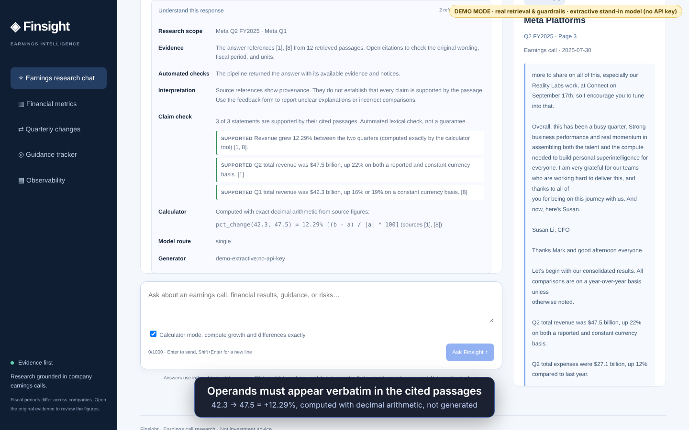

# 📈 Finsight: AI Financial Research Assistant

[](https://github.com/ankur1902/finsight-ai/actions/workflows/ci.yml)


## Demo

[**Watch the 85-second walkthrough**](docs/demo/finsight-demo.mp4) · cited answers, claim-level checks, calculator mode, prompt-injection defence, red-team scoreboard, guidance tracker, observability.



The video was recorded keyless with `demo/demo_server.py`: real retrieval over the PDFs, guardrails, claim checks,
calculator and tracker, but an **extractive stand-in instead of an LLM** (labelled in the video). Reproduce it with
`demo/start_api.sh & demo/start_web.sh &` then `node demo/record.js`.

## What makes Finsight different

| Capability | Where | Try it |
|---|---|---|
| **Red-team benchmark**: 49 attacks, attack-success-rate before vs after hardening, known gaps published | `src/eval/redteam.py`, [scoreboard](docs/redteam-scoreboard.md) | `make redteam` |
| **Claim-level verification**: every sentence marked supported / partial / unsupported / uncited against its cited passages | `src/claims.py`, chat "Understand this response" | ask any question |
| **Guidance-vs-actual tracker**: management's next-quarter guidance parsed with exact quotes, compared with the reported result | `src/guidance.py`, `GET /guidance`, sidebar "Guidance tracker" | `/guidance?company=meta&period=Q1-2025` |
| **Observability**: per-stage p50/p95 latency, token and cost estimates, Prometheus text, optional OpenTelemetry | `src/observability.py`, `GET /observability/*` | sidebar "Observability" |
| **Eval in CI**: retrieval, groundedness and red-team gates run offline on every push, with badges | `src/eval/ci_gate.py`, `.github/workflows/ci.yml` | `make gate` |
| **Model router + semantic cache**: cheap model for lookups, strong model for comparisons, escalation on failure; paraphrase cache that cannot cross periods, numbers or direction | `src/router.py`, `src/semantic_cache.py` | `FINSIGHT_ROUTER=1 FINSIGHT_STRONG_MODEL=... FINSIGHT_SEMANTIC_CACHE=1` |
| **Calculator tool (agentic mode)**: the model proposes arithmetic, Python Decimal computes it, and each operand must appear verbatim in the cited passage | `src/agent.py`, `src/calculator.py` | tick "Calculator mode" in chat, or `"agentic": true` |
| **One-command demo** | `docker-compose.yml` | `docker compose up --build` |

Honest limits: guidance parsing is rule-based and tuned on the Meta/NVIDIA phrasing (Microsoft rarely
gives company-level numeric guidance, so it often returns nothing); claim checking is lexical plus
numeric, not an entailment model (a `judge` hook is provided); the red-team suite documents attacks
that still get through (non-English, base64, letter-spaced injections); cost figures are estimates.
See [demo script](docs/demo-script.md) for a 2-minute walkthrough.

## Overview

For the current uncommitted implementation, see [engineering challenges and decisions](docs/engineering-decisions.md) and [the change inventory and validation plan](docs/uncommitted-review.md). The October 11 hardening changes were written without running the project or tests.

Finsight is a Retrieval-Augmented Generation (RAG) powered financial intelligence platform that enables investors and analysts to query and analyze quarterly earnings call transcripts from leading companies such as Meta, NVIDIA, and Microsoft.

The system combines semantic search, vector databases, and Large Language Models (LLMs) to provide accurate, citation-backed answers grounded in company earnings discussions and financial disclosures.

---

## Features

* 📄 Automated ingestion of earnings call transcripts and financial documents
* ✂️ Intelligent document chunking and preprocessing
* 🔍 Hybrid retrieval using semantic vector search and keyword matching
* 🧠 Context-aware question answering with Hugging Face LLMs
* 📚 Source-grounded responses with document citations
* 📊 Analysis of quarter-over-quarter company performance
* 💬 Interactive Streamlit-based chat interface
* ⚡ Local-first architecture with no dependency on external APIs

---

## Architecture

```text
Financial Reports / Earnings Call Transcripts
                    │
                    ▼
            Document Loader
                    │
                    ▼
           Text Chunking Layer
                    │
                    ▼
          BGE-M3 Embeddings
                    │
                    ▼
          Chroma Vector Store
                    │
                    ▼
      Hybrid Retrieval (MMR)
                    │
                    ▼
        Context Construction
                    │
                    ▼
        Hugging Face LLM
                    │
                    ▼
      Citation-Backed Answers
                    │
                    ▼
          Streamlit Frontend
```

---

## Tech Stack

### AI & Machine Learning

* LangChain
* Hugging Face Transformers
* BAAI/bge-m3 Embeddings
* Qwen/Qwen2.5-0.5B-Instruct / Hugging Face LLMs

### Vector Database

* ChromaDB

### Data Processing

* PyMuPDF (fitz)
* RecursiveCharacterTextSplitter

### Frontend

* Next.js / React / TypeScript for the analytics workspace
* FastAPI for the analytics API
* Streamlit for the existing chat interface

### Programming Language

* Python 3.11

---

## Results & Evaluation

Hybrid Retrieval Performance

| Metric                     | Score  |
| -------------------------- | ------ |
| Precision@K                | 74.29% |
| Hit@K                      | 88.89% |
| Mean Reciprocal Rank (MRR) | 0.857  |
| Keyword Recall@K           | 100%   |

### Key Insights

* Achieved perfect keyword recall across evaluation queries.
* High MRR indicates relevant chunks are consistently ranked near the top.
* Strong retrieval accuracy for earnings-call-specific financial questions.
* Improved answer grounding through hybrid retrieval and citation-based responses.

---

## Installation

### 1. Clone Repository

```bash
git clone https://github.com/ankur1902/finsight.git
cd finsight
```

### 2. Create Virtual Environment

```bash
python -m venv .venv
```

Activate:

Windows

```bash
.venv\Scripts\activate
```

Mac/Linux

```bash
source .venv/bin/activate
```

### 3. Install Dependencies

```bash
pip install -r requirements.txt
```

### 4. Add Documents

Place earnings call transcripts or financial reports inside:

```text
data/
```

Example:

```text
data/
├── meta-Q1-2025.pdf
├── nvidia-Q4-2025.pdf
└── microsoft-Q2-2025.pdf
```

### 5. Build Vector Database

```bash
python -m src.main
```

### 6. Launch Application

```bash
streamlit run app.py
```

---

## Example Questions

* How did NVIDIA's data center revenue change this quarter?
* What risks did Meta management highlight during the earnings call?
* Compare Microsoft's AI investments across recent quarters.
* What guidance did management provide for next quarter?
* Summarize key business highlights from the latest earnings call.

---


## Author

Ankur Singh

Built as a Retrieval-Augmented Generation (RAG) system for financial intelligence and earnings call analysis.

## Next.js analytics workspace

### Gemini upgrade (October 9, 2026)

The backend now supports the official Google GenAI SDK. Add `GEMINI_API_KEY` to
the project-root `.env` file, which is excluded from Git. `.env.example` contains
the non-secret settings. The current verified configuration uses
`gemini-3.1-flash-lite`, minimal thinking and three retrieved passages. Existing
shell environment variables take precedence over `.env`; restart the backend
after changing provider settings. API usage consumes your provider quota.

Gemini defaults to fast, metadata-scoped lexical retrieval over cached PDF
snapshots, without loading BGE or a cross-encoder. Set
`FINSIGHT_RETRIEVAL_MODE=hybrid` to retain the existing semantic retriever. Lexical
search is a performance/recall tradeoff, not equivalent to semantic retrieval.
Gemini warms the retriever and SDK before accepting requests. Hosted chat no
longer waits for the local-model inference lock. Batched structured extraction
uses one generation call per reporting period; all quotations and values are
still validated locally. Missing/invalid facts remain withheld.

Validated, warning-free chat replies have a bounded ten-minute in-memory cache,
keyed by exact question/context, model, prompt and generation settings. Cache
hits are labeled in the frontend; feedback tokens are generated separately for
every delivered reply. The response cache is cleared when the backend restarts.
PDF changes invalidate the corpus snapshot and lexical index.

Only benchmark-passing question shortcuts are served by `GET /questions`. The
manifest `verified_questions.json` is tied to the corpus, model, prompt, retrieval
code and settings. Repeat live checks with an authorized provider key:

```powershell
.venv/Scripts/python.exe -m src.eval.verify_questions --runs 3 --limit 4 --publish
```

This invokes real, uncached Gemini generation and consumes quota. The current
manifest includes only Microsoft Cloud revenue: all three checked answers were
correct and completed within five seconds. Three other questions passed accuracy
but had occasional latency outliers, so they are not advertised as fast shortcuts.
See [the Gemini verification report](docs/gemini-verification-2026-10-09.md).

The new frontend lives in `frontend/` and connects to a lazy-loading FastAPI backend.
The existing Streamlit chat remains available. The analytics workspace reads PDFs
from `data/` directly, so no Chroma rebuild is required for these two features.

### Financial Metric Dashboard

- Select Meta, Microsoft, or NVIDIA and a fiscal reporting quarter.
- AI extracts actual quarterly revenue, gross/operating margins, diluted EPS,
  capital expenditure, and NVIDIA Data Center revenue when disclosed.
- Every displayed fact includes an exact transcript quotation and a PDF page link.
- Guidance is excluded from actual-result cards. Conflicting values are withheld.
- View up to six historical periods, grouped by matching units, scope, and accounting basis.
- Export results and their evidence as JSON.

### Quarterly Change Analyst

Compare an earlier baseline with a later reporting period. The analyst produces
before/after evidence for guidance, risks, AI investment, and business drivers.
It also calculates comparable metric changes using Python Decimal arithmetic;
margin differences are percentage points, and relative change is unavailable
for a non-positive baseline. Missing periods are not interpolated.

### Run locally (when ready)

Python 3.11+ and Node.js 20.9+ are required. Install backend dependencies:

```bash
python -m pip install -r requirements.txt
python -m uvicorn src.api:app --host 127.0.0.1 --port 8000
```

In a separate terminal:

```bash
cd frontend
npm ci
# Copy .env.example to .env.local and adjust FINSIGHT_API_URL if needed.
npm run dev
```

Open the frontend at http://localhost:3000. In an existing container setup, set
`FINSIGHT_API_URL` to the backend address reachable **from the Next.js server**,
for example a service hostname on your Docker network. The URL is server-only;
the browser calls the same-origin Next.js API proxy. No Docker services are
started or modified by this implementation.

Model configuration reuses `src/config.py`: `FINSIGHT_LLM_PROVIDER=local` forces
local inference; `FINSIGHT_LOCAL_MODEL` selects the local model. The default
small local model may return malformed JSON or miss facts. Such responses are
reported as partial extraction, never replaced with fabricated/demo data.
Models must already be downloaded for offline inference. To use the configured
Anthropic provider, set `ANTHROPIC_API_KEY`, `FINSIGHT_LLM_PROVIDER=anthropic`, and
`FINSIGHT_ANTHROPIC_MODEL` to a model available to your account. API costs apply.

First analysis can take several minutes. Successful results are stored in
`analytics_cache.sqlite3`, keyed by model, operation, and transcript contents.
Malformed generation results are not cached, so retrying can recover. The Next.js
proxy times out after ten minutes; backend computation may continue and populate
the cache. Changes compare a bounded selection of topic excerpts, rather than
establishing exhaustive absence/presence of a topic.

Quotation/value validation verifies provenance, units and magnitude; it does
not prove every semantic interpretation by the model. Review evidence, especially
for reporting-period attribution and GAAP classifications. Narrative findings
are explicitly marked as AI interpretations. This app is intended for local
research; add authentication and deployment controls before exposing it publicly.

### API and offline checks

- `GET /health`: server readiness without loading models.
- `GET /catalog`: available fiscal periods and metric labels.
- `GET /metrics?company=meta&period=Q1-2025`: extract/cache metrics.
- `POST /changes`: JSON `{ "company": "meta", "before": "Q1-2025", "after": "Q2-2025" }`.
- `GET /documents/{filename}`: existing corpus PDFs only.

```bash
python -m pytest -q
cd frontend
npm run typecheck
npm run build
```

Backend regression tests use fake generators and in-process HTTP clients. They
require no model downloads, external API calls, browser, or running Docker services.


## Next.js RAG chat and citations

The default Next.js view is now **Earnings research chat**. Financial metrics and
quarterly changes remain available from the sidebar. The chat calls the existing
RAG pipeline through `POST /chat`, proxied by Next.js at `/api/chat`.

The interface supports multi-turn questions, Markdown tables, input limits,
loading/cancellation, retries, starting a new conversation, copying answers, and
exporting the conversation with its source evidence. Numbered references such
as `[1]` or `[1, 3]` open an evidence panel showing the full retrieved passage,
company, fiscal period, call date, and PDF page link. Each reply has its own
citation scope. Unknown references are displayed as text rather than fabricated
source links. Guardrail warnings and abstentions are surfaced with the answer.

The API is stateless: the client sends at most 12 bounded history messages.
The backend redacts personal information in history, drops instruction-like
history, reconstructs follow-up scope against the actual retriever catalog,
and does not accept caller-supplied query plans. Conversations are held in page
memory rather than shared server state or browser local storage. Models load
lazily, and inference is serialized across chat and analytics requests.

Unlike the metric extractor, **RAG chat requires the existing Chroma index**.
For new or changed PDFs, build it with `python -m src.main` before using chat.
The document coverage panel reflects PDFs on disk; it does not claim that every
PDF is already indexed. Set the backend URL in `frontend/.env.local` as described
above. No new browser-side model/API keys are needed.

Example request:

```json
{
  "question": "And what about their capex?",
  "history": [
    { "role": "user", "content": "What was Meta revenue in Q2 2025?" },
    { "role": "assistant", "content": "Revenue was $47.5 billion [1]." }
  ]
}
```

Response fields: `question` (redacted), `answer`, `sources` (including full
`excerpt` and source-local numeric IDs), `flags`, `blocked`, structured `plan`,
and `timings_ms`. Prior citations in history are not treated as evidence for a
new reply; new answers must cite the current retrieval results.

Offline frontend verification now also includes `npm test`, which tests real
Markdown/citation rendering in memory, without a browser or running application.


## Answer feedback and financial visualization

The frontend implements the reviewed design as production React components;
preview/sample content is kept outside the project. Chat answers now include an
**Understand this response** section explaining resolved scope, source references,
and automated notices. **Explain in plain language** prepares a follow-up question
for review before sending it through the same grounded RAG pipeline.

Each registered reply supports **Helpful** / **Needs improvement** feedback.
Users can identify accuracy, relevance, clarity, citation, missing-context,
fiscal-period, or unit issues, attach the reply's source numbers, and add an
optional note. Feedback is persisted through `POST /feedback`; updates replace
the current review for that answer, and retries reuse an idempotency identifier.
The backend validates that attached source IDs belong to the server's original
answer snapshot. Answers remain usable if review storage is unavailable.

Review snapshots and feedback are stored in `feedback.sqlite3`. Defaults retain
answers for 30 days; expired snapshots and associated feedback are pruned on
new answer registration. `FINSIGHT_FEEDBACK_DB` selects the database path and
`FINSIGHT_FEEDBACK_RETENTION_DAYS` accepts 1–365 days. Snapshots contain the
redacted question, generated answer, sources, notices, and the model identity recorded by the actual generation phase, not
full conversation histories. Replies without a recorded generation phase are
labeled as pipeline responses rather than attributed to an unused model. Answer-scoped random tokens authorize feedback;
only their hashes are stored, and tokens are omitted from conversation exports.
Optional notes are redacted for the existing PII patterns. Notes are untrusted
review data and are never inserted into generation prompts or used for automatic
training. The redaction patterns are not a guarantee that all personal data can
be identified; the form asks users to avoid personal information.

For local review of aggregate counts, the following command is available when
you choose to run it:

```bash
python -m src.eval.feedback_report --output feedback-report.json
```

The report contains counts by model, rating, and issue category. It contains no
questions, notes, or answer tokens, and does not label user ratings as objective
financial accuracy. No unauthenticated HTTP review-data export is provided.

**Financial metrics:** interactive SVG trend charts preserve fiscal-quarter
spacing, show missing quarters as gaps, group matching units/accounting bases/
scopes, and link observations to exact source quotations. Keyboard-accessible
point controls and a data table provide alternative access to the evidence.
Axis labels are rounded for readability; selected observations preserve extracted
precision. The value axis includes zero, including when values are negative.

**Quarterly changes:** paired bar charts compare actual results with matching
accounting bases and units. Margin differences are shown in percentage points.
Relative growth is withheld for zero or negative baselines; absolute changes
remain available. The UI labels multi-quarter comparisons and separates calculated
metric differences from AI narrative interpretations. Chart colors identify
periods without treating every increase as favorable.

The page delegates to focused feature components, a cancellation-aware analytics
hook, shared HTTP handling, and runtime response validators. Outdated responses
cannot overwrite a newer selection. Historical loading retains completed results
if a later period fails. The Next.js proxy enforces endpoint-specific methods,
JSON bodies, and a 256 KiB request limit; feedback has a separate short timeout.
No additional charting packages are required.

Verification on October 7, 2026: all 66 backend tests and 14 frontend tests pass;
TypeScript, production build, and formatting checks pass. Browser integration
checks cover citations, source-bound feedback, financial trends, quarterly charts,
PDF links and mobile layout. Chart success uses a clearly labeled deterministic
test model with quotations from real PDFs; it does not establish AI accuracy.
Live local generation exposed an incorrect, uncited segment-revenue answer and
financial extraction exceeded the ten-minute proxy limit. Output guardrails now
withhold uncited answers and numbers absent from cited passages. Numerical support
still does not prove that a model interpreted the right financial scope.
See [the verification report](docs/verification-2026-10-07.md) for evidence, fixes,
remaining limitations and reproduction steps. The current local AI configuration
has not passed production readiness checks.

CPU generation now uses float32 rather than checkpoint-selected bfloat16. The
Node proxy uses a compatible Undici dispatcher with explicit header/body timeouts
in addition to its request abort deadline. Testing can isolate state with
`FINSIGHT_PERSIST_DIR`, `FINSIGHT_ANALYTICS_CACHE`, `FINSIGHT_FEEDBACK_DB`, and
`FINSIGHT_TRACE_FILE`. The in-memory frontend test loader uses Node.js 24's
CommonJS/ESM interoperability.
