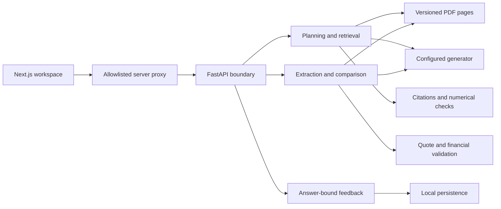

# Finsight: challenges and engineering decisions

Date: October 11, 2026. This record covers the current uncommitted implementation and the latest static code review. It explains decisions, alternatives, costs, and remaining limitations. It is not a production-readiness certificate.

No application, browser, provider call, test suite, type check, formatter, build, or ingestion command was run for this review. Earlier verification reports describe older code and remain historical evidence.

## Architecture

Next.js owns interaction, charts and evidence inspection. Python owns retrieval, generation, financial validation, arithmetic and review storage. Provider keys belong only in the backend environment. The retained Streamlit interface now uses the same retrieval selection and verified examples; Next.js is the primary frontend.

## 1. A fluent answer is not a verified financial result

Earlier local-model output confused company revenue with segment revenue and omitted citations. Increasing the output budget could not fix that reliably.

**Decision:** apply input, retrieval and output checks outside the model. Plan company/fiscal period, filter suspicious passages, require valid citations and withhold numerical answers unsupported by cited passages. A recognized refusal is blocked and cannot enter the successful-answer cache. Negative signs are now preserved, including `-$3.30` and the Unicode minus sign, so positive evidence cannot validate a negative output.

**Cost and limit:** conservative checks reject some useful answers. Numerical presence and provenance do not prove semantic correctness, unit scale, causal claims or accurate attribution of every sentence. Accounting parentheses and all possible numerical notations are not comprehensively handled. This remains research requiring evidence review.

Files: `query_planner.py`, `prompts.py`, `guardrails.py`, `rag.py`, `chat.py`.

## 2. Filenames and calendar quarters can misidentify the evidence

Some transcript filenames disagree with the actual fiscal quarter. Companies also use different fiscal calendars.

**Decision:** transcript headers take precedence over filename fallbacks. Preserve source name, PDF page, company, fiscal quarter/year and call date throughout the pipeline. A shared corpus snapshot avoids repeated PDF parsing. The latest change compares file signatures before and after loading, retries once on a detected update, and rejects repeatedly unstable input.

**Cost and limit:** metadata detection supports specific transcript formats. Corrupt PDFs cause a safe request failure rather than silently becoming evidence. There is no OCR pipeline. Changes preserving filename, size and modification time can evade signature-based refresh detection.

Files: `ingest.py`, `chunking.py`, `corpus.py`.

## 3. Retrieval and generation costs need separate optimization

Neural retrieval and local CPU generation previously had substantial startup and inference costs. A tiny local model was also unreliable at citations.

**Decision:** Gemini defaults to lexical BM25L retrieval with financial vocabulary normalization and company/period filters. Retain hybrid dense/BM25 retrieval with reranking as an explicit option. Lazy imports avoid loading unused neural models. Local CPU generation uses float32 to avoid the previously observed bfloat16 slowdown.

**Cost and limit:** lexical retrieval can miss paraphrases. Hybrid retrieval improves semantic matching at additional memory and latency cost. Lexical relevance scores and cross-encoder scores are evaluated separately. Existing ranking heuristics do not hardcode answer values. The hybrid rebuild still deletes its collection before repopulating; safe live reindexing needs versioned collections and atomic activation.

Files: `retrieval.py`, `lexical_retriever.py`, `hybrid_retriever.py`, `embeddings.py`, `vectorstore.py`, `llm.py`.

## 4. Hosted failures should be actionable without exposing private details

Provider quota, inaccessible models, credentials, timeouts and truncated output previously collapsed into generic failures. SDK exception text can include request details.

**Decision:** classify safe provider errors: 429 for quota/rate limits, 503 for credential/model access configuration, 504 for recognized timeouts, and 502 for other generation failures. Do not relay arbitrary SDK exception bodies or automatically retry paid generation. Require usable, nonempty completed output. Gemini non-STOP and Anthropic truncated output are rejected.

Hosted calls share `FINSIGHT_PROVIDER_TIMEOUT_MS`, default 15,000 ms. Configuration choices, token budgets, retrieval counts and finite relevance thresholds are checked before serving requests.

**Cost and limit:** exceptions without recognizable status metadata use a generic failure. A quota reset time is not invented. Model-specific thinking support still depends on the configured model/account. Less raw error detail is logged; controlled, redacted diagnostics may be needed to investigate a failure.

Files: `config.py`, `errors.py`, `llm.py`, `api.py`.

## 5. Structured output constrains syntax, not truth

Earlier Gemini calls rejected some keywords emitted by the full Pydantic schema.

**Decision:** send the supported structural grammar, resolve references, and select the numeric Decimal alternative. Independently enforce Pydantic constraints and evidence validation after generation. Strict JSON parsing now rejects duplicate keys, NaN/Infinity and non-object roots; malformed output is not repaired into a published fact.

**Cost and limit:** the provider sees fewer constraints than the backend, so local validation may reject generated facts. The schema adapter supports the current extraction models, not every arbitrary recursive schema or union.

Files: `llm.py`, `analytics.py`.

## 6. Accounting scope and arithmetic need explicit rules

Annual guidance, prior quarters, segment results, growth rates, adjusted results and basic EPS must not be mislabeled as quarterly consolidated metrics.

**Decision:** require the exact source quote, page, reported value/unit, compatible period, scope and accounting basis. Require explicit diluted wording for the metric labeled Diluted EPS. Withhold conflicts and missing values. Calculate changes using Decimal; compare only matching metric/unit/basis/scope. Margins use percentage points. Zero/negative baselines have absolute changes but no relative growth percentage. Frontend validators also check arithmetic before rendering.

**Cost and limit:** conservative text patterns are not a complete accounting ontology. A quote containing several financial figures remains an attribution challenge. A short quote can omit the diluted qualifier, causing EPS to be withheld. Unit conversions and inferred estimates are intentionally not generated.

Files: `analytics.py`, `frontend/lib/finance.ts`, `frontend/lib/contracts.ts`.

## 7. Quarterly narratives need evidence from both periods

Frequent phrases can crowd out guidance/capex evidence. A missing excerpt does not prove an issue was absent from an entire call.

**Decision:** select bounded evidence across guidance, risk, AI investment and business drivers. Validate exact before/after quotes and numerical support in summaries. Separate AI interpretations from calculated differences. The prompt forbids claiming a topic is new, absent or resolved merely because a selected excerpt was missing. Label nonconsecutive comparisons.

**Cost and limit:** narratives are selective interpretations, not exhaustive coverage. Verified quotes do not prove the model's causal interpretation.

Files: `analytics.py`, quarterly analyst and chart components.

## 8. Cache speed must not become a correctness or availability dependency

Stale evidence, failed extraction, SQLite contention and corrupt cache rows can undermine otherwise valid analysis.

**Decision:** chat caches only successful flag-free answers, uses bounded TTL/LRU and deep copies, and includes model/settings/prompt/history/context in its identity. Every delivered response gets a new feedback capability, including cache hits.

Analytics identity includes cache version, task, model, thinking level and transcript contents/metadata. Recheck cached structure and evidence, and recalculate cached comparison deltas. Unavailable SQLite or malformed entries fall back to fresh generation. Failed cache writes preserve validated results. A short SQLite busy timeout limits contention. The version changed after the stricter EPS validation; no existing cache was deleted by this review.

**Cost and limit:** fallback generation costs provider requests and time. Analytics storage has no size/age cleanup policy yet. Chat cache is per process and disappears on restart. Fresh analytics misses remain serialized and may queue behind other work. Client cancellation does not reliably cancel synchronous backend generation or refund provider work.

Files: `answer_cache.py`, `analytics.py`, `runtime.py`, `rag.py`, `api.py`.

## 9. HTTP and browser failures need bounded, consistent behavior

Delayed replies can overwrite a newer selection, uploads can hang before forwarding, and validation can echo a private token or note.

**Decision:** keep cancellation controllers and request epochs, validate runtime contracts, preserve a caller's abort reason, and sanitize network failures. Client/proxy deadlines are 15 seconds for catalog/questions, 30 for feedback, 45 for chat and 600 for extraction/comparison. The longer analytics budget retains the local-generator option; it is not an expected latency.

The proxy allowlists endpoints/methods/segments, bounds JSON bodies, checks document filenames and validates its backend URL. Body reads now observe cancellation. Direct backend JSON POST requests have a separate 256 KiB limit and 15-second upload deadline. Validation responses omit submitted values. Ordinary API logs record error class/status rather than exception bodies; optional judge reports also omit raw failures.

**Cost and limit:** these are request boundaries, not authentication or a provider-independent generation deadline. Cancellation protects UI state while a backend worker may continue. No new browser verification is claimed.

Files: `http_boundary.py`, `api.py`, frontend API helper/proxy, analytics hook and research chat.

## 10. Citations, charts and feedback need inspectable evidence

**Decision:** answer-scoped citation controls open full source excerpts and PDF page links; select the first source actually cited by the answer. Disable raw HTML/unsafe external content. Charts preserve fiscal spacing, missing periods, compatible accounting series and zero baselines, with keyboard controls and evidence tables.

Feedback stores an exact answer snapshot, authorizes edits with a random answer-scoped token whose hash is persisted, validates attached sources and uses idempotent submission receipts. Notes use existing PII redaction and remain untrusted review data. Tokens are omitted from exports. Feedback does not enter prompts or automatic training; storage failure preserves the answer.

**Cost and limit:** custom SVG charts require accessibility/layout regression checks. Feedback capabilities are not user authentication, and PII redaction is incomplete. SQLite needs durable storage/backups when hosted. Browser downloads were previously inconclusive and are not freshly verified.

Files: citation/evidence/assessment/chart/feedback frontend components, `feedback.py`, `feedback_report.py`, frontend citation/chat helpers.

## 11. Verified examples cannot guarantee a five-second answer

The earlier October 11 live check produced a correct cited Microsoft Cloud answer in **10,759.87 ms fresh**, followed by **50.71 ms cached**. Earlier three-run fast benchmarks therefore do not guarantee future latency.

**Decision:** publish examples only after repeated uncached gold-case checks against a matching corpus/configuration. Fingerprint relevant pipeline and evaluation source files, expire manifests after seven days, and reject malformed, future-dated, duplicate or slow entries. Stale verification returns an empty shortcut list.

**Cost and limit:** the historical manifest is preserved but will be hidden after these source changes. A new manifest requires a permitted live verification run. Passing a sample is past evidence, not a promise of perfect output or an SLA. Automatic invalidation based on each subsequent live answer's latency is not implemented.

For a future five-second target, measure uncached p50/p95 separately, precompute validated facts, add deterministic fact-lookup routes for narrow metric questions, evaluate smaller contexts/output budgets, and add admission control and provider-aware time budgets. Streaming improves perceived progress, not completion time. These are future steps, not implemented guarantees.

Files: `questions.py`, `verification.py`, `eval/verify_questions.py`, `verified_questions.json`, question picker.

## Remaining public-hosting work

Authentication/user isolation, admission control, spend limits, managed secrets, durable storage/backups, dependency locking, versioned index activation and production latency/accuracy evaluation remain necessary. No public deployment, index rebuild or service restart was performed in this review.

See [uncommitted review](uncommitted-review.md) for the full working-tree inventory and validation plan.
